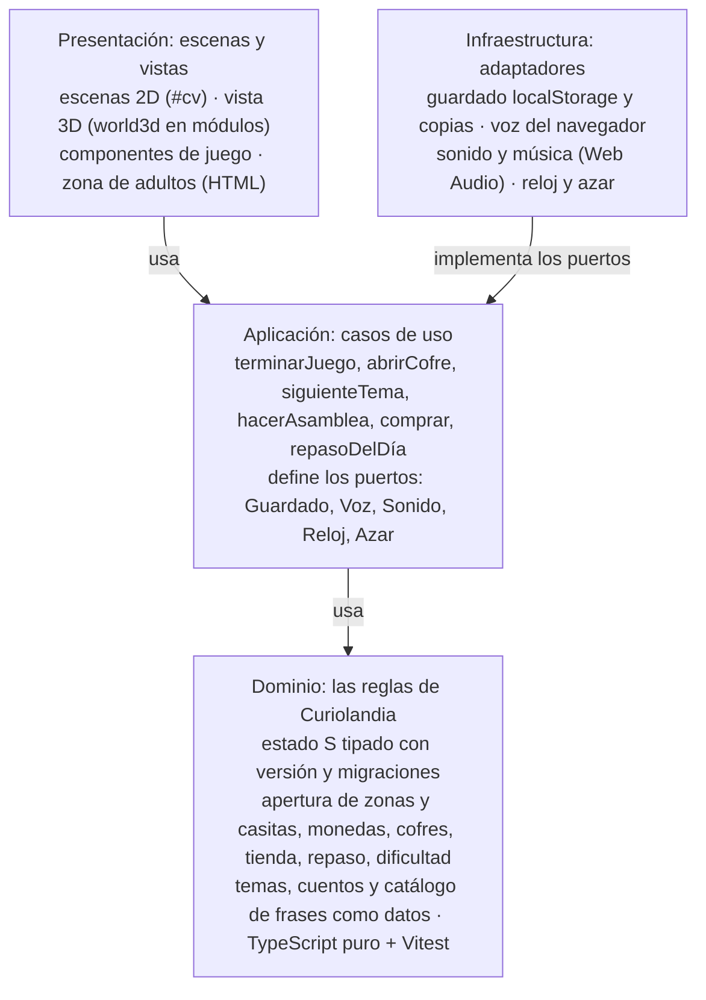
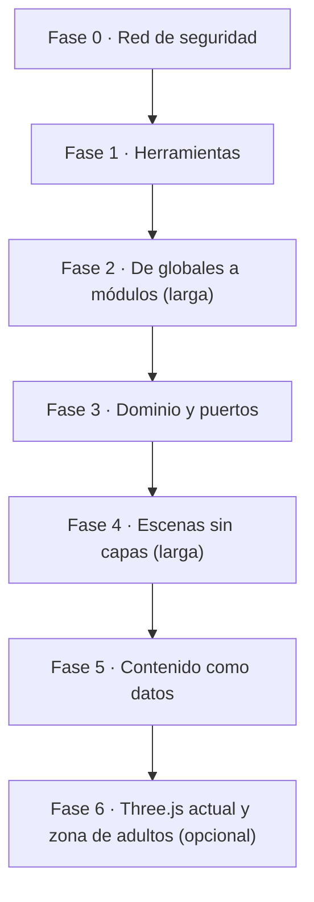

# Plan de migración de Curiolandia 3D a TypeScript y arquitectura limpia

Escrito el 23 y 24 de octubre de 2026 con Fernando. Es la versión del repo del documento de trabajo
[Curiolandia 3D: migración a arquitectura limpia](https://claude.ai/artifact/6sp7FQAvERP6wEPG83Qc2W).
**Estado: fases 0 y 1 publicadas; fase 2 en marcha (24 de octubre de 2026): 2a hecha (VIVO y `pon*`) y 2b en marcha (los dibujos ya son módulos).** Código importado de `curiolandia-3d` en el commit `dd5fc61` (v1.592).

## 1. Resumen

**Decisión: TypeScript + Vite, sin framework de interfaz, manteniendo Three.js, con una migración gradual por fases.**
Al acabar cada fase el juego se puede publicar y pasa la misma batería de pruebas que hoy (los 253 juegos, el camino
por edades, los 45 casos límite, audio y los fallos B1-B7).

- **Angular no encaja.** Está pensado para aplicaciones de formularios y páginas HTML. Curiolandia dibuja todo en dos lienzos (2D y WebGL) 60 veces por segundo.
- **React, Vue o Svelte tampoco** para el juego. Como mucho uno ligero (Preact o Lit) para la zona de adultos, que sí es HTML. Opcional y al final.
- **Phaser o Babylon obligarían a reescribir** los 253 juegos o todo `world3d.js`. El problema es de organización, no de motor.
- **La "arquitectura limpia" es el objetivo real**: tipos para el estado guardado `S`, módulos con dependencias explícitas y una capa de reglas del juego (progreso, monedas, cofres, repaso) que no sabe nada de pantalla y se prueba en milisegundos.

### Por qué merece la pena

Fernando quiere que el juego crezca: base de datos, conexión con servicios, traducción. Con la arquitectura de hoy, cada
novedad se añade envolviendo lo anterior (unas 80 envolturas; `world3d.js` pesa 300 KB). Con puertos y adaptadores,
una base de datos en la nube es otro adaptador del puerto Guardado y los juegos no se enteran. El coste son varias semanas
sin novedades visibles para el niño.

## 2. Repos

| Repo | Papel |
| --- | --- |
| `fercala/curiolandia-3d` | El juego actual (JavaScript, publicado). **Solo lectura** para esta migración: es la referencia de comportamiento. |
| `fercala/curiolandia-new` | Este repo. Aquí se hace la migración, con `npm`, Vite y TypeScript. Se publica en GitHub Pages con una GitHub Action que ejecuta `npm run build`. |
| `fercala/curiolandia` | El juego 2D original. No se toca. |

Consecuencias:

- **Tarea horaria.** La tarea "dos mejoras cada hora" sigue haciendo commits en `curiolandia-3d`. Mientras dure la migración, sus mejoras se portan aquí (o se para la tarea cuando el repo nuevo tome el relevo; decisión pendiente).
- **Partidas guardadas.** Los dos repos se publican en `fercala.github.io`, y el navegador guarda por dominio. El juego nuevo usa **su propia clave de guardado** y copia la partida vieja (`localStorage`, clave de `curiolandia-3d`) solo la primera vez.
- **Caché del service worker.** Nombre de caché propio (prefijo distinto de `curiolandia3d-`) y nunca borrar cachés de otros juegos del mismo dominio.
- **Instalación.** Quien tenga el juego instalado en el móvil instala la versión nueva desde su dirección.

## 3. Punto de partida (repo `curiolandia-3d`, v1.589)

24 archivos `.js` en `src/` (unos 700 KB de código propio, sin contar Three.js r128) que `src/build.sh` pega en un solo `<script>`.

1. **Todo es global.** `S`, `scene`, `idle`, `T`, `ctx`, `SCENES`, `say`... se comparten, y varios archivos *reasignan* variables `let` de `core.js`. El orden de `build.sh` es la única arquitectura. Es el mayor obstáculo para pasar a módulos: un módulo no puede reasignar una variable que importa.
2. **Escenas por capas.** `zonas.js`, `tienda.js`, `repaso.js` y `world3d.js` envuelven métodos de escenas anteriores (`enter0`, `down0`...): unas 80 envolturas, 50 en `world3d.js`. `scenes.js` arrastra código antiguo sin uso (ver `docs/PROBLEMAS-CONOCIDOS.md` del repo viejo).
3. **Reglas mezcladas con dibujo.** Apertura (`zoneOpen`, `temaOpen`, `gameOpen`, `NEED`), monedas, cofres (`GIFTS`) y repaso viven junto al código de pintar y de sonido.
4. **`world3d.js` (300 KB) es un archivo único** con mapa, zonas, casitas, cofre, portada, Tito, Pipo y la proyección 3D→2D.

A favor:

- Las pruebas de `tests/regresion/` son de **caja negra**: juegan siguiendo `scene.hint()` y leen el juego por `window.__cl` (`go`, `S`, `scene`, `name`, `TEMAS`). Sirven para validar cada fase si `__cl` se mantiene como contrato.
- La proyección del 3D a la pantalla lógica de 1600x900 (`MZ2`, `ZPOS`, `stationPos`, `TITO`, `HOUSE_AT`) ya es, en el fondo, un adaptador: se formaliza, no se tira.

Lectura obligada del repo viejo antes de empezar: `docs/ARQUITECTURA.md`, `docs/ESTADO-GUARDADO.md`, `docs/COMO-AGREGAR.md`, `tests/regresion/LEEME.md`.

## 4. Opciones comparadas

| Opción | Qué aporta aquí | Qué cuesta | Veredicto |
| --- | --- | --- | --- |
| **TypeScript + Vite, sin framework** | Tipos (sobre todo `S` y temas), módulos, servidor con recarga al instante, compilación a una web estática, Vitest | `npm` y un paso de compilación | **Elegida** |
| Solo JSDoc + `// @ts-check` | Tipos sin cambiar lenguaje ni montaje | Sigue todo global | Útil como paso intermedio, no destino |
| Angular | Estructura marcada, inyección de dependencias | Pensado para formularios y DOM; pesado | Descartada |
| React / Vue / Svelte | Interfaces HTML | El juego es lienzo; estorba en el bucle de 60 fps | Solo, opcional, para la zona de adultos (Preact o Lit) |
| Phaser (motor 2D) | Escenas, entrada, sonido hechos | Reescribir 253 juegos y `comps*.js` | Descartada |
| Babylon.js / PlayCanvas | Motor 3D completo | Reescribir `world3d.js` para obtener lo mismo | Descartada |
| Mantener Three.js | Ya funciona (toon, contornos, caché de geometría) | Está en r128 (2021) | **Se mantiene**; se actualiza en la fase 6 |

## 5. Arquitectura objetivo

Las dependencias apuntan hacia el dominio. El dominio no sabe nada de lienzos, Three.js, audio ni `localStorage`.

- **Reloj y azar son puertos.** Hoy las pruebas fijan fecha y hora desde fuera (noche tras las 20 h, medianoche, cumpleaños, hemisferio sur). Con un puerto `Reloj` esas reglas se prueban sin navegador.
- **La proyección 3D→2D se queda** como interfaz explícita ("dónde está cada cosa en la pantalla lógica"). Vista 2D y 3D son dos implementaciones, no una capa que envuelve a otra.
- **`window.__cl` es un contrato** de las pruebas de Playwright y conserva sus nombres.

## 6. Voces: solo la voz del navegador

**Decisión del 24 de octubre de 2026:** el juego nuevo no lleva las voces grabadas. Todo lo dice la voz del navegador (`speechSynthesis`).

- **Fuera:** `voz/`, `voz-fer/` y sus manifiestos (la mayor parte de los ~70 MB de la web), la mezcla MP3 + voz del navegador, el montaje de frases con números por piezas, `herramientas/voces/` y la parte del gancho de commits que para commits por frases sin grabar.
- **Se conserva:** el puerto Voz (un solo adaptador); la elección de voz de la zona de adultos con las más naturales primero y la guía para instalar voces mejores (v1.589); las pruebas de audio con voz de mentira.
- **Frases:** catálogo con identificador, en castellano de España; los textos ya se pueden mejorar libremente. El catálogo sirve para revisar y para traducir. Pendiente de confirmar con Fernando: dejar `dialogos/pendientes.txt` (solo tenía sentido para grabar) y quedarse con el catálogo general.
- **A tener en cuenta:** la calidad depende del dispositivo (Edge/Windows "Natural" muy bien; algunos Android robótica). Algunas voces "online" necesitan internet. En iPhone la voz arranca tras un primer toque.
- **Si un día se quiere voz de calidad:** otro adaptador del puerto Voz (MP3 generados o un servicio de voz), sin tocar los juegos.

## 7. Fases

Cada fase es una rama y un PR pequeño que se fusiona en `main` de este repo y se publica.

Puerta entre fases: humo, camino 3/4/5, los 253 juegos, límites, audio, informe-b y voces en verde (adaptados a voz del navegador).
Las fases 0 a 3 dan casi todo el beneficio; se puede parar después de cualquiera.

0. **Red de seguridad.** Importar el código de `curiolandia-3d` (versión de referencia fijada por commit) sin las voces grabadas, con su montaje actual, y publicarlo desde este repo para comprobar que funciona igual. GitHub Actions que monta la web y pasa `humo.js`, `informe-b.js`, `voces.js` y una muestra de `juegos.js` en cada PR. Guardar la línea base: tamaño, FPS en el mapa, lista de juegos que terminan. Documentar qué promete `window.__cl`. Nueva clave de guardado + copia única de la partida vieja.
1. **Herramientas sin mover código.** `package.json` con Vite, TypeScript y Vitest. El montaje sigue concatenando en el mismo orden (un plugin de Vite hace lo que hoy hace `build.sh`). `globales.d.ts` declara los tipos de `S`, los temas y las escenas; `tsc --checkJs` empieza a avisar. Ganchos de commit (`comentarios.py`, catálogo de frases) leen `.ts`. Workflow de Pages con `npm run build`.
2. **De globales a módulos.** Primero, las variables que otros archivos reasignan (`scene`, `idle`, `T`, `ctx`, `talking`...) pasan a un objeto de estado compartido. Luego cada archivo a `.ts` con `import`/`export`, en el orden de `build.sh`: `pics-*` (datos puros), `lex`, `core` (partido en utilidades, sonido, voz y escenas), componentes, temas, escenas. Las envolturas siguen, importadas en el mismo orden.
3. **Dominio y puertos.** A `dominio/`: apertura (`zoneOpen`, `temaOpen`, `gameOpen`, `NEED`), monedas y cofres (`GIFTS`), tienda, repaso y dificultad, guardado con versión y migraciones. Cada regla con pruebas de Vitest. Las escenas llaman a casos de uso en vez de tocar `S`.
4. **Escenas sin capas.** Cada escena definida una vez, juntando lo que añaden `zonas.js`, `tienda.js`, `repaso.js` y `world3d.js`. `world3d.js` partido (motor y materiales, isla, zonas, casita, cofre, portada, Tito y Pipo); la proyección como interfaz. Borrar el código antiguo.
5. **Contenido como datos.** Temas, cuentos y dibujos en archivos de datos tipados. Catálogo de frases con identificador (`say(F.bienvenida)`), del que sale `dialogos/todos.csv`. Prepara la traducción.
6. **Opcional.** Three.js de r128 a una versión actual desde `npm` (revisar toon y contornos). Preact o Lit para la zona de adultos si crece.

Orden de magnitud (aproximado): fases 0 y 1, uno o dos días cada una; 2 y 4, varios días cada una; 3 y 5, por partes.

## 8. Riesgos

| Riesgo | Cómo se evita |
| --- | --- |
| Romper partidas guardadas | Clave propia, copia única de la vieja, tipo + versión + migraciones; pruebas con partidas viejas y rotas (`limites.js`). |
| Voz del navegador distinta según el móvil | Elección de voz y guía de la zona de adultos; puerto Voz abierto a otro adaptador. |
| Ganchos de commit rotos | Se adaptan a `.ts` en la fase 1, antes de mover nada. |
| Divergencia con el repo viejo | Portar las mejoras de la tarea horaria o pararla; anotar en `docs/CAMBIOS.md` qué commit del viejo se ha portado. |
| Migración a medias | Cada fase deja el juego publicable y es útil sola. |
| Rendimiento en móviles viejos | Comparar tamaño y FPS con la línea base en cada fase. |
| Sin conexión | Service worker propio con caché versionada, generado en el build. |

## 9. Base de datos y servicios (después de la migración)

- La base de datos es un adaptador más del puerto Guardado (por ejemplo Supabase o Firebase); GitHub Pages solo sirve archivos.
- **Local primero:** el juego funciona sin conexión; la nube sincroniza cuando puede.
- **Privacidad de menores (RGPD):** datos mínimos, consentimiento de la familia, sin anuncios ni rastreadores, borrado fácil.
- **Servicios** (cuentas de familia, informes para el cole, sincronizar móviles): un puerto y un adaptador cada uno, activables desde la zona de adultos.

## 10. Después: spec-kit

Tras la migración se trabajará con spec-kit y Claude Code. El borrador de constitución está en [CONSTITUCION-BORRADOR.md](CONSTITUCION-BORRADOR.md); se pasará al archivo de constitución de spec-kit cuando se instale.

## 11. Decisiones

| Fecha | Decisión |
| --- | --- |
| 2026-10-23 | TypeScript + Vite sin framework, con `npm`; se mantiene Three.js. |
| 2026-10-23 | Repo nuevo `curiolandia-new`; `curiolandia-3d` queda como referencia de solo lectura. |
| 2026-10-23 | No empezar hasta que Fernando termine los últimos cambios en la versión original. |
| 2026-10-24 | Sin voces grabadas: solo voz del navegador. |

Pendientes: cuándo parar la tarea horaria del repo viejo (o portar sus mejoras); hasta qué fase llegar; si se mantiene `dialogos/pendientes.txt`.

## 12. Herramientas disponibles para Claude

Plugins instalados por Fernando el 24 de octubre de 2026: Design (accesibilidad, crítica de diseño, textos), ux-ui-audit,
TypeScript Patterns Enforcer, frontend-design, playwright y UX Agent Skills. Comprobados el 24 de octubre de 2026:

- **TypeScript Patterns Enforcer**: funcionan la guía (`/typescript-patterns-enforcer:check`), el agente de revisión y el
  gancho que revisa cada `.ts` al guardarlo. El gancho bloquea `any`, bucles `for`/`while`, `switch`, números mágicos,
  `.then()`, `@ts-ignore` sin TODO y regex sin ejemplo. Los comentarios de cabecera en castellano no los marca. Al pasar
  código viejo a `.ts` (fase 2) saltará mucho: se puede silenciar por archivo con
  `/* eslint-disable ts-patterns/<regla> */` y quitarlo al limpiar ese archivo.
- **Design, ux-ui-audit y frontend-design**: cargan. Los conectores de Design (Figma, Slack, Notion...) no conectan en la
  nube; no hacen falta.
- **playwright**: funciona con el gancho de inicio [.claude/hooks/chrome-playwright.sh](../.claude/hooks/chrome-playwright.sh),
  que crea el lanzador de Chrome en cada sesión. La red de la nube no deja abrir `fercala.github.io`: se prueba en local.
- **UX Agent Skills**: no carga como plugin (depende de `web-quality-skills`, que no está en el catálogo). Hay una copia
  local en `.claude/skills`, `.claude/agents` y `.claude/scripts`; ver [.claude/LEEME.md](../.claude/LEEME.md).
